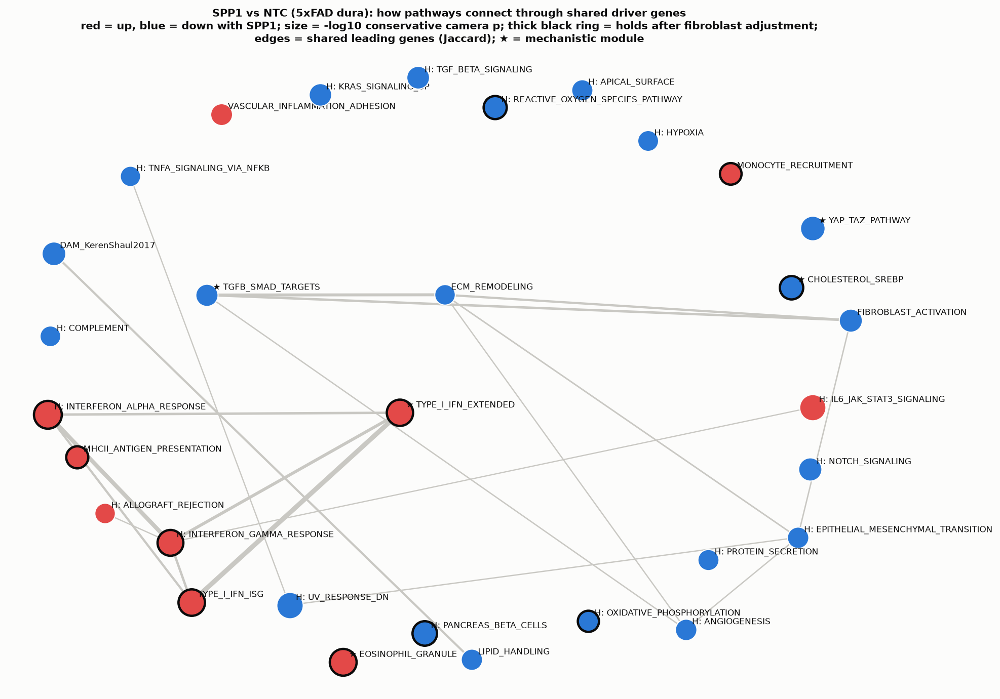

# How the SPP1-targeting pathways might link biologically (5xFAD dura, SPP1 vs NTC)

Scripts: `13a` (fibroblast-adjusted genome-wide DESeq2), `13b` (camera on gene sets), `13c` (link map, mechanistic genes, PANTHER/IPA kits), `13d` (IFN/eosinophil robustness). n = 6 vs 6 (3F/3M each), all 5xFAD.

## Bottom line

The SPP1-targeted dura splits into **two layers that share almost no genes**:

1. **Matrix / YAP-TAZ / TGF-β layer (down).** This is mostly explained by **fewer fibroblasts** in the SPP1 samples. It shows up clearly in the unadjusted model and fades once fibroblast content is adjusted for. The single genes that survive adjustment are **Prg4, Cldn11 and Bhlhe40**.
2. **Myeloid / interferon / eosinophil layer (up), plus cholesterol synthesis (down).** This **gets stronger** after fibroblast adjustment, but it tracks monocyte and neutrophil content closely. It is at least partly a change in **which immune cells are present**, with possibly a modest IFN cell-state shift on top.

Nothing here passes FDR. Treat this as a structured set of hypotheses to test by staining, not as findings.



## 1. Evidence

### Gene-set tests: limma camera, conservative variant (inter-gene correlation estimated per set)

| Model | Set | Dir | p | Leading genes |
|---|---|---|---|---|
| unadjusted | YAP/TAZ pathway (mech.) | ↓ | 0.039 | Wwtr1, Tead1, Amot, Sav1 |
| unadjusted | Eosinophil granule (mech.) | ↑ | 0.045 | Prg2, Prg3, Epx, Ear1/2, Alox15 |
| unadjusted | DAM (Keren-Shaul) | ↓ | 0.052 | Spp1, Trem2, Tyrobp, Cst7, Lgals3, Fabp5 |
| unadjusted | Fibroblast activation | ↓ | 0.064 | Fn1, Lox, Timp1, Col12a1, Cthrc1, Fap |
| unadjusted | Hallmark TGF-β | ↓ | 0.072 | Bmp2, Skil, Smad3, Wwtr1 |
| unadjusted | TGF-β/SMAD targets (mech.) | ↓ | 0.085 | Fn1, Lox, Timp1, Col3a1, Skil, Bhlhe40 |
| unadjusted | Hallmark EMT | ↓ | 0.11 | collagens, Fn1, Lox… |
| fibro_adj | Hallmark IFN-α response | ↑ | 0.012 | Irf7, Irf9, Isg15, Ifit2/3, Cxcl10, Bst2 |
| fibro_adj | Eosinophil granule | ↑ | 0.018 | as above |
| fibro_adj | Type I IFN ISG / extended | ↑ | 0.020 | Rsad2, Isg20, Ifit1, Mx1, Oasl2 |
| fibro_adj | Hallmark IL6/JAK/STAT3 | ↑ | 0.022 | Stat1, Irf1, Irf9, Cxcl10, Csf2ra, Csf3r |
| fibro_adj | Hallmark IFN-γ response | ↑ | 0.025 | Icam1, Gbp6, Irf1, Stat1 |
| fibro_adj | Cholesterol/SREBP (mech.) | ↓ | 0.058 | Insig1, Sqle, Msmo1, Idi1 |

Best conservative FDR: about 0.59 (unadjusted) and 0.34 (fibro_adj). With the limma default correlation (0.01), many of these reach FDR < 1e-10, but that default ignores gene-gene co-variation and is too liberal here. Full table: `../tables/spp1_pathway_camera_both_models.tsv`.

### Genome-wide fibroblast-adjusted DESeq2 (13a)
Five genes reach padj < 0.05: **Rsad2** ↑ (+1.41), **Isg20** ↑, **Apol11b** ↑, **Spock1** ↓, **Hpcal4** ↓. The two IFN genes are the only "significant" signal in the whole SPP1 comparison after adjustment.

### Mechanistic genes
Values are log2FC, unadjusted → fibro-adjusted. Full table: `mechanistic_axis_genes.csv`; heatmap: `SPP1_mechanistic_axis_genes.png`.

- **Ligand/receptors.**
  - Spp1 −1.27 (p 0.018) → −0.94. This fits SPP1 targeting, but the drop is male-driven, and bulk Spp1 is mostly osteoclast-derived.
  - Itgav −0.53 → −0.36; Itgb3 −0.81 → −0.28; Cd44 −0.43 (n.s.).
- **YAP/TAZ.** Wwtr1 (TAZ) −0.38 (p 0.001), Tead1 −0.21, Amot −0.33, Sav1 −0.26. All are attenuated by adjustment.
  - Canonical targets Ccn1/Ccn2 are unchanged.
  - **Ankrd1 is up (+1.75)**, the opposite of what reduced YAP/TAZ activity predicts. Ankrd1 is also a muscle stress gene, so it may reflect adjacent muscle tissue.
- **TGF-β/SMAD.** Bmp2 −0.58, Smad3 −0.26, Skil −0.42, Bhlhe40 −0.56 (still −0.46, p < 0.05, after adjustment).
  - **Tgfb1 itself trends up** (+0.41 → +0.72), probably from myeloid cells, so ligand and response point in opposite directions.
- **Matrix output.** Fn1, Lox, Loxl3, Col3a1, Col12a1, Fbln1, Timp1 and Cthrc1 are all down; all except Loxl3 lose significance after adjustment. Prg4 and Cldn11 (arachnoid/meningeal barrier) stay down.
- **IFN.** Rsad2, Isg15, Ifit1, Ifit3b and Cxcl10 are up in both models and stronger after adjustment. Irf7, Stat1 and Irf9 become significant after adjustment.
- **Cholesterol.** Insig1 −0.54 (p 3e-4), Sqle, Msmo1, Idi1 and Ldlr are down after adjustment only. Ch25h, Cyp7b1 and Srebf2 are unchanged.
- **Eosinophil.** Prg2, Prg3, Epx, Ear2 and Alox15 are up 1–3.6 log2 in both models.

### Is the immune layer just more immune cells? (13c, 13d)
Within the 12 5xFAD animals:
- The IFN score correlates with the monocyte signature (ρ = 0.92) and the neutrophil signature (ρ = 0.64).
- The eosinophil score correlates with monocyte (ρ = 0.80) and neutrophil (ρ = 0.74).

The SPP1 effect on each score, standardised, with exact within-sex permutation p:

| Covariates | IFN score | Eosinophil score |
|---|---|---|
| sex only | +0.95 SD (p 0.09) | +1.20 (p 0.04) |
| + fibroblast | +1.58 (p 0.02) | +1.64 (p 0.03) |
| + monocyte | +0.39 (p 0.28) | +0.76 (p 0.13) |
| + neutrophil | +0.84 (p 0.16) | +0.90 (p 0.02) |
| + fibroblast + monocyte | +0.78 (p 0.11) | +0.99 (p 0.15) |

Reading the table:
- The **IFN signal is mostly carried by monocyte content.** Adjusting for monocytes removes about 60% of the effect.
- The **eosinophil signal partly survives** neutrophil adjustment, but not monocyte adjustment.
- The monocyte signature itself trends higher with SPP1. So "more monocytes, which are IFN-primed" and "SPP1 loss induces IFN" cannot be separated in bulk tissue.

## 2. A working model: how the pathways could connect

Directionality: the perturbation **reduces** SPP1 (Spp1 mRNA −1.27). Everything below is framed as the consequence of **less osteopontin signalling in 5xFAD dura**.

```
                          SPP1 targeting  (Spp1 ↓)
                                │
          ┌─────────────────────┴───────────────────────┐
          ▼                                             ▼
 Stromal / fibroblast arm                     Myeloid / immune arm
 SPP1 → integrin αvβ3/β5 + CD44 on            SPP1 is a myeloid survival/retention and
 fibroblasts → FAK/RhoA tension               "DAM/lipid-associated" macrophage factor
          │                                   (DAM genes ↓: Spp1, Trem2, Tyrobp, Cst7)
          ▼                                             │
 TAZ (Wwtr1) / TEAD1 ↓                         Shift in myeloid composition:
          │                                    fewer SPP1+ DAM-like macrophages,
          ▼                                    more monocytes (+0.4 vs −0.7 SD),
 SMAD3 / TGF-β target output ↓                 neutrophil and eosinophil signal ↑
 (Skil, Bhlhe40, Bmp2)                                  │
          │                                   ┌─────────┴────────────┐
          ▼                                   ▼                      ▼
 Matrix production ↓                  Type I IFN / ISG ↑     Eosinophil granule ↑
 (Fn1, Col3a1, Col12a1, Lox, Timp1)   (Rsad2, Isg15, Irf7;   (Prg2/3, Epx, Ear2)
 + fewer fibroblasts (−1.1 SD)         SPP1 normally restrains
          │                            pDC/macrophage IFN — loss
          ▼                            de-represses it?)
 Arachnoid/barrier genes ↓                    │
 (Cldn11, Prg4, Tjp1)                         ▼
                                       IFN → Ch25h/25-HC → SREBP2 ↓ ?
                                       (Insig1, Sqle, Msmo1, Idi1 ↓;
                                        but Ch25h itself unchanged)
```

### Hypothesis A: SPP1 → integrin/CD44 → YAP/TAZ → matrix (stromal arm)
- **Mechanism.** Osteopontin binds αvβ3/αvβ5 integrins and CD44 and promotes fibroblast adhesion, migration and FAK/RhoA-dependent YAP/TAZ nuclear entry. YAP/TAZ and SMAD3 co-activate matrix genes (Fn1, Col, Lox, Timp1).
- **Fit to the data.**
  - In favour: losing SPP1 should lower Itgav/Itgb3, TAZ/TEAD1, SMAD3 targets and matrix output, which is what the unadjusted data show.
  - Against: Ccn1/Ccn2, the best YAP/TAZ readouts, are unchanged, and Ankrd1 goes the wrong way.
- **Main problem:** most of this layer vanishes after fibroblast adjustment. The simplest explanation is **fewer fibroblasts** (or less fibroblast-rich dissection), not lower YAP/TAZ activity per fibroblast. The two are not exclusive: SPP1 is a fibroblast survival and proliferation cue, so fewer fibroblasts could itself be the biological effect.

### Hypothesis B: SPP1 ↔ TGF-β (cross-talk)
- **Mechanism.** In fibrosis, SPP1 and TGF-β reinforce each other: TGF-β induces Spp1, and SPP1 enhances TGF-β activation and SMAD signalling via αvβ integrin-mediated latent-TGF-β release.
- **Fit to the data.** SMAD targets and Bmp2 are down while the Tgfb1 ligand trends up. That pattern suggests reduced **activation or response** rather than reduced ligand. αv integrins (Itgav ↓) are the main activators of latent TGF-β, so this is a plausible link to test.

### Hypothesis C: SPP1 loss → myeloid remodelling → IFN
- **Mechanism.** SPP1 is a hallmark of DAM/lipid-associated and border-associated macrophages and helps retain them. Intracellular osteopontin (iOPN) is needed for TLR9 → IRF7 → type I IFN signalling in plasmacytoid DCs, so loss would predict *less* IFN. Secreted OPN, however, restrains some inflammatory macrophage programmes. Our data (DAM down, IFN up) fit a **shift in the macrophage pool** away from SPP1+ DAM-like cells toward monocyte-derived, IFN-responsive cells. This is consistent with monocyte content explaining most of the IFN effect.
- **Interpretation.** In 5xFAD this matters because meningeal and dural macrophages handle amyloid/CSF drainage. An IFN-high monocyte influx could be either protective or harmful.

### Hypothesis D: IFN → cholesterol synthesis ↓
- **Mechanism.** Type I IFN represses SREBP2-driven sterol synthesis, partly via Ch25h/25-hydroxycholesterol.
- **Fit to the data.** The cholesterol genes fall only in the fibroblast-adjusted model, where IFN is strongest. That matches the mechanism, but Ch25h is unchanged, so the link is speculative. It could also be a myeloid composition effect, since macrophages are sterol-synthesis-high.

### Hypothesis E: eosinophils
- Granule genes are up 1–3.6 log2, robust to fibroblast and neutrophil adjustment but not monocyte adjustment.
- Possible sources:
  - **Genuine dural eosinophils**, which are reported in meninges, can be IL-5/ILC2-driven, and interact with mast cells.
  - **Bone-marrow carry-over** from the skull. Prg2/Prg3/Epx are expressed mostly in eosinophil *precursors*, so marrow contamination is a real concern.
- The eosinophil score does not track the bone signatures: ρ = −0.08 with osteoblast and −0.23 with osteoclast (`eosinophil_and_IFN_vs_composition.csv`). That argues against bone fragments, but it does not rule out marrow cells: the eosinophil score tracks the neutrophil signature (ρ = 0.74), and neutrophils are also marrow-derived.
- Linking eosinophils to SPP1 loss directly is the weakest of these hypotheses.

## 3. What would test this (staining)

| Hypothesis | Stain (dura whole-mount or section) | Prediction if real |
|---|---|---|
| A, YAP/TAZ | YAP/TAZ nuclear:cytoplasmic ratio in PDGFRα+ or DCN+ fibroblasts | Lower nuclear TAZ in SPP1 **per fibroblast** |
| A, fibroblast number | PDGFRα+ cell density; Ki67 or cleaved caspase-3 in PDGFRα+ | Fewer fibroblasts (composition), or no change (per-cell regulation) |
| A/B, matrix | Fibronectin, collagen III, LOX intensity normalised to PDGFRα area | Down per fibroblast area = real regulation |
| B, TGF-β | pSMAD2/3 nuclear in fibroblasts; integrin αv | Lower pSMAD2/3 with SPP1 targeting |
| Barrier | Claudin-11, E-cadherin (arachnoid barrier cells) | Thinner or discontinuous Cldn11 layer |
| C, myeloid | CD206/LYVE1 (BAM), CD11b + Ly6C (monocytes), SPP1 or OPN protein, CD68 | Fewer SPP1+ macrophages, more Ly6C+ monocytes |
| C, IFN | ISG15 or IFIT3 with CD11b or Iba1 co-stain | ISG+ cells are myeloid (composition) or also stromal (state change) |
| E, eosinophils | Siglec-F + MBP (Prg2) or EPX; check skull-marrow-free dura | Siglec-F+ cells in the dura proper, more in SPP1 |
| Amyloid | Aβ (6E10 or MOXO4) in dura and meningeal lymphatics (LYVE1) | Any SPP1-dependent change in dural Aβ or clearance |

The single most informative experiment: **co-stain PDGFRα + TAZ and CD11b + ISG15 in the same dura**. That tells apart "fewer fibroblasts / more monocytes" from "cells changing state", which bulk RNA cannot do. The sorted CD11b+/ACSA-2+ dataset (see `sorted_cells_handoff/`) can also test Hypothesis C directly: are ISGs higher *within* CD11b+ cells?

## 4. Caveats
- **n = 6 vs 6**, no FDR-significant gene sets, and only 5 genome-wide genes, all in the adjusted model. All p-values above are nominal.
- **Camera default vs conservative.** Claims rely on the conservative variant. The liberal default p-values (down to 1e-24) are not trustworthy here.
- **Circularity.** The fibroblast adjustment uses a marker signature (Pdgfra, Dcn, Fbln1, Mfap4, Igfbp6, Slc47a1, Col14a1, Smoc2). Those genes, and anything tightly co-expressed with them, are partly adjusted for themselves (flagged in the 13a table).
- **Over-adjustment.** If SPP1 genuinely reduces fibroblast numbers, adjusting for fibroblast content removes a real effect. Both models are shown for that reason.
- **Monocyte confound.** The immune layer is not adjusted for monocyte content in the genome-wide model; see the 13d table.
- **Spp1 knockdown** is male-driven and measured mostly from osteoclast-derived Spp1, so knockdown efficiency in the targeted cells is unknown.
- **Technical axis.** The WT vs 5xFAD comparison is confounded by a dissection/technical axis (earlier steps). Within-5xFAD SPP1 vs NTC is less affected, but composition differences are still the main alternative explanation for everything above.
- **Local tools only.** PANTHER, IPA, GO and Reactome servers were unreachable from the analysis environment. Upload kits for running them are in `../13_pathway_kits/`.
