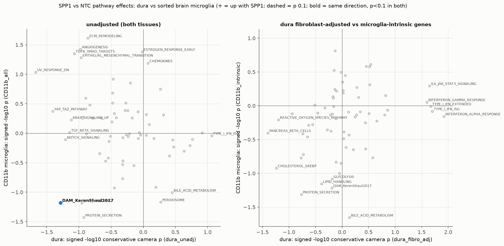

# SPP1 vs NTC pathway links in sorted CD11b+ microglia, and how they compare with dura

Scripts:
- `14a`: microglia-intrinsic gene flags
- `14b`: DESeq2 and camera
- `14c`: link map, cross-tissue comparison, upload kits

The approach mirrors dura step 13 (`../../composition_confounding_analysis/13_pathway_links/REPORT.md`).

**Data.** Whole-brain CD11b+ sort (96–99% microglial RNA), 5xFAD, all male, **n = 3 vs 3**.

## Bottom line
1. **Spp1 is knocked down in both tissues.** Microglia −0.81 log2 (−43%, padj 2e-7, #1 gene); dura −1.27 unadjusted.
2. **Microglia lose a lipid-associated arm of the plaque response, not the plaque response itself.**
   - Down: Gpnmb −0.74, Ch25h −0.51, Apoe −0.36, Fabp5 −0.31, Igf1 −0.26, all p < 0.01 and all microglia-intrinsic.
   - Unchanged: the core DAM genes (Cst7, Itgax, Trem2, Tyrobp, Clec7a) and the homeostatic genes (P2ry12, Tmem119, Cx3cr1, Sall1).
   - Camera, intrinsic genes, conservative p: MGnD 0.036, ARM 0.042, lipid module 0.053, DAM 0.061, all down.
3. **Cholesterol synthesis (SREBP2 targets) goes down in both tissues.** This is the one pathway pointing the same way in dura and microglia.
   - Insig1 is the lead gene in both: dura fibro-adj −0.54 (p 3e-4); microglia −0.39 (p 0.006).
   - Hmgcr, Ldlr, Cyp51, Msmo1 and Idi1 follow.
   - Fabp5 is also down in both.
   - Each tissue is only nominal on its own: conservative camera p 0.058 (dura) and 0.12 (microglia).
4. **The dura interferon signal is not in microglia.**
   - Every ISG is flat: Isg15 +0.12, Irf7 +0.19, Ifit3 −0.15, Stat1 −0.08.
   - The interferon sets have p ≥ 0.7 in both universes.
   - This fits the dura analysis, where the interferon signal tracked monocyte content. It is a dura-local or composition effect, not a brain-wide myeloid interferon response.
5. **Matrix / YAP-TAZ / TGF-β is not a microglial effect.**
   - In CD11b these sets go *up*, the opposite of dura, but the drivers (Col3a1, Ccn1/2, Fn1, Timp1, Cldn11) are all flagged as carry-over: vascular/fibroblast, BAM or glial.
   - Microglia-intrinsic TGF-β/YAP genes are flat. The receptors Cd44, Itgav and Itgb1/3/5 are unchanged.
6. **Eosinophil genes** (Prg2, Epx, Alox15) are not expressed in microglia. Ear2 is BAM-derived.

Across all shared gene sets, dura (fibroblast-adjusted) and microglia (intrinsic) effects correlate weakly (Spearman ρ = 0.35). The two unadjusted analyses anti-correlate (ρ = −0.21), because each tissue's composition artifact runs in a different direction.



## 1. Evidence

### Camera, conservative variant (inter-gene correlation estimated per set)

| Universe | Set | Dir | p |
|---|---|---|---|
| mg_intrinsic | Hallmark bile-acid metabolism | ↓ | 0.022 |
| mg_intrinsic | MGnD (Krasemann) | ↓ | 0.036 |
| mg_intrinsic | ARM (Sala Frigerio) | ↓ | 0.042 |
| mg_intrinsic | Hallmark protein secretion | ↓ | 0.049 |
| mg_intrinsic | Lipid module | ↓ | 0.053 |
| mg_intrinsic | DAM (Keren-Shaul) | ↓ | 0.061 |
| mg_intrinsic | DAM2 | ↓ | 0.070 |
| mg_intrinsic | Glycolysis | ↓ | 0.083 |
| mg_intrinsic | Cholesterol/SREBP (mech.) | ↓ | 0.119 |
| mg_intrinsic | Hallmark cholesterol homeostasis | ↓ | 0.169 |
| all_genes | ECM remodeling | ↑ | 0.024 (carry-over) |
| all_genes | Angiogenesis, TGF-β/SMAD targets, EMT, chemokines, monocyte recruitment | ↑ | 0.04–0.07 (carry-over) |
| either | Interferon sets (Hallmark α/γ, ISG, IRM) | — | ≥ 0.7 |

- Best conservative FDR is about 0.4. **Nothing passes FDR**; with the default (liberal) correlation, DAM/lipid reach FDR < 1e-4.
- Every intrinsic hit is **down**. The "up" sets disappear once carry-over genes are removed.
- Full results: `../tables/CD11b_pathway_camera_both_universes.tsv`.

### Link map (`CD11b_pathway_link_map.png`)
- One connected cluster: MGnD, ARM, DAM, DAM2 and the lipid modules, linked through shared genes (Gpnmb, Apoe, Ch25h, Fabp5, Igf1, Spp1).
- A separate carry-over cluster: ECM, TGF-β/SMAD, EMT and YAP targets.
- Cholesterol/SREBP stands alone: its genes (Insig1, Hmgcr, Ldlr, Cyp51) are not DAM genes.

### Gene-level comparison
See `mechanistic_genes_dura_vs_CD11b.png` and `.csv`.

| Axis | Dura | Microglia |
|---|---|---|
| Spp1 | ↓ | ↓ |
| Lipid-DAM (Gpnmb, Apoe, Ch25h) | flat | ↓ |
| Core DAM (Cst7, Trem2, Tyrobp) | ↓ (DAM-like macrophages fewer) | flat |
| Fabp5 | ↓ | ↓ |
| SREBP2 targets (Insig1, Hmgcr, Ldlr, Cyp51, Sqle, Idi1) | ↓ (fibro-adj) | ↓ |
| ISGs | ↑ | flat |
| Matrix/YAP/TGF-β | ↓ (fibroblast composition) | ↑ (carry-over) |
| Eosinophil | ↑ | not expressed |

## 2. Updated model across both tissues

```
                       SPP1 targeting  (Spp1 mRNA ↓ in microglia and dura)
                                       │
            ┌──────────────────────────┼─────────────────────────────┐
            ▼                          ▼                             ▼
   SHARED: sterol program ↓     MICROGLIA: lipid-associated     DURA ONLY (local/composition)
   Insig1, Hmgcr, Ldlr, Cyp51,  arm of DAM ↓                    fewer fibroblasts → matrix/YAP/TGF-β ↓
   Sqle, Idi1 (SREBP2 targets)  Gpnmb, Apoe, Ch25h, Fabp5, Igf1  more monocytes → ISG/IFN ↑
   + Fabp5 ↓                    core DAM (Cst7/Itgax/Trem2) =    eosinophil granule genes ↑
                                homeostatic =                    core DAM genes ↓ (fewer DAM-like macs)
```

### Hypothesis 1 (new, strongest cross-tissue link): SPP1 loss lowers cellular sterol synthesis
- **Evidence.** The same SREBP2 target genes fall in two independent datasets and cell compartments, led by Insig1, which is itself an SREBP target.
- **Mechanism, speculative.**
  - OPN–CD44/integrin signalling activates PI3K–AKT–mTORC1, and mTORC1 is a major activator of SREBP processing.
  - Hallmark mTORC1 signalling is also down in microglia (intrinsic p 0.009 liberal / 0.19 conservative) and dura (fibro-adj, conservative p 0.19).
  - So the chain could be: less SPP1 → less mTORC1 → less SREBP2 → lower sterol synthesis.
- **Alternative.** Fewer lipid-laden/plaque-engaged cells could need less de novo cholesterol, so the change would follow the lipid-DAM decrease.
- **Ruled out in microglia.** The dura idea "IFN → Ch25h/25-HC → SREBP2 ↓" cannot apply there: microglia have no interferon increase, and Ch25h is *down*, which would push SREBP2 *up*.
- **Test.** Filipin or BODIPY staining (free cholesterol / lipid droplets) in plaque-associated microglia; pS6 (mTORC1 readout) in IBA1+ cells.

### Hypothesis 2: SPP1 is part of, or upstream of, the lipid-associated (Gpnmb/Apoe) microglial state
- In 5xFAD, Spp1, Gpnmb, Apoe and Ch25h mark lipid-laden, plaque-associated microglia, the "lipid-droplet-accumulating" / Gpnmb-high subset.
- Knockdown lowers that arm but leaves the Trem2/Cst7/Itgax core intact, and the DAM2 score with Spp1 removed changes only about 3%.
- Two readings, which bulk data cannot separate:
  - (a) fewer cells in the lipid-high subset, or
  - (b) the same cells expressing less of the lipid program.
- **Test.** GPNMB or APOE immunostaining around plaques (fraction of plaque-associated IBA1+ cells that are GPNMB+); single-cell or sorted-subset data.

### Hypothesis 3, revised: the dura interferon signal is local to the dura
- Brain microglia show no ISG change. So the dura increase is not a body-wide or CNS-wide interferon response to the treatment, for example vector or oligo sensing; that would likely have reached microglia too.
- This supports the dura conclusion that interferon tracks monocyte influx.
- **Caveat.** Dural macrophages and monocytes were not sorted here. The sorted ACSA-2 fraction also showed no interferon change once astrocyte share was normalised.

### Not supported in microglia
- SPP1 → CD44/integrin → YAP/TAZ → matrix. Receptors and YAP/TAZ are flat in intrinsic genes. This axis, if real, belongs to dural fibroblasts.

## 3. Staining priorities (both tissues)

| Question | Brain | Dura |
|---|---|---|
| Knockdown | SPP1/OPN protein in plaque-associated IBA1+ cells | OPN in dural macrophages/osteoclasts |
| Lipid-DAM arm | GPNMB, APOE in plaque-associated microglia; plaque-microglia contact count | — |
| Sterol program | Filipin / BODIPY in IBA1+ cells; pS6 (mTORC1) | Filipin in PDGFRα+ fibroblasts and CD206+ macrophages |
| Interferon | ISG15 in IBA1+ (expect no change) | ISG15 + CD11b / Ly6C (expect monocyte-associated) |
| Fibroblast/matrix | — | PDGFRα density, nuclear TAZ, fibronectin |
| Amyloid | Plaque load (6E10, Thioflavin-S) | Dural Aβ |

## 4. Caveats
- **n = 3 vs 3, all male.** Exact permutation p can be no smaller than 0.1. Only Spp1 is robust per gene; all pathway p-values are nominal.
- **Carry-over adjustment.** The covariate model (`~ carry_astro + treatment`) is near-collinear (r = 0.84) and inflates effects (e.g. Dhcr24 −1.25). Claims rely on the unadjusted model in the intrinsic universe.
- **The intrinsic filter is reference-based.** Microglia-expressed genes also made by BAM or vascular cells (Cd44, Igf1, Rsad2, Ifit1) are excluded conservatively. Their unadjusted values are still in the tables.
- **Library-quality difference by arm** (SPP1 more unmapped reads) and **one SPP1 replicate driving a stress/glucocorticoid signature** (Fkbp5, Tsc22d3, Sgk1); see `EXECUTIVE_SUMMARY.md`.
- **Different tissues, possibly different animals.** Dura (n = 6v6, both sexes) and brain sorts (n = 3v3, male) may not come from the same mice. Agreement between them is therefore independent replication, but disagreement could be tissue *or* cohort.
